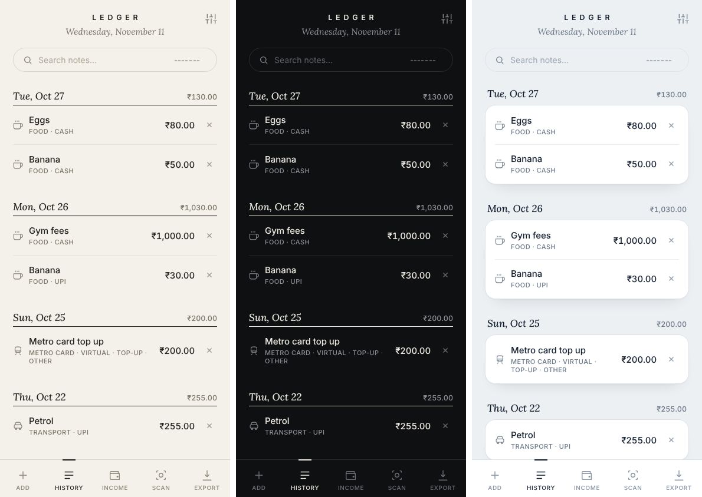

# Ledger: daily expenses

A private, fast expense tracker for everyday spending in rupees. Log what you spend in a few seconds, see where the money goes, track money you receive, and share clean reports. It works as a website, as a home-screen app, and as an Android app that keeps your data in a real file on your phone.



## Features

- **Quick logging**: amount, note, category, how you paid, and a date (today, yesterday or any day). Voice entry is supported on browsers that offer it.
- **Edit and delete safely**: tap an entry to edit it; deleting always asks first.
- **Money received**: record income and see your balance for any month.
- **Metro card**: Virtual or Physical card, top-up or fare. Top-ups count as spending; fares are listed but not double-counted.
- **Export and share any period** (day, week, month, all time or a custom range) as **Image, PDF report, JSON, CSV or Text**.
- **PDF analysis report**: totals, category breakdown, a chart over time, biggest expenses and every transaction.
- **Scan old notes**: photograph handwritten expense pages and import them (OCR, needs internet).
- **App lock**: fingerprint / face unlock, PIN or pattern.
- **Three designs**, chosen in the settings sheet (the sliders icon): **Atelier** (ivory and ink, the default), **Graphite** (charcoal and sage) and **Porcelain** (cool white and navy). Quiet, typographic, hairlines instead of boxes, with serif numerals. Plus six colour themes: Classic Paper, Midnight Gold, Emerald Luxe, Royal Sapphire, Rose Noir, Ivory & Gold.
- **Works offline** once opened, and installs like an app.
- **Backups**: one tap to download everything as JSON; import skips anything already present, so restoring twice is safe.

## Where your data is stored

Ledger has no server and no account. Nothing leaves your device unless you export or share it.

| How you run it | Where the data lives |
| --- | --- |
| **Android app (APK)** | A real file in the app's **private** storage (`Ledger/ledger-data.json`, plus a previous-version spare copy). Other apps cannot read it. Data from older builds that sat in a shared folder is moved in automatically. |
| **Website / home-screen app** | The browser's IndexedDB database, requested as *persistent* storage so it isn't cleared when space is low. Not the page's `localStorage`. |

A website cannot write files to a phone by itself (that is a browser rule, not something this app can change). If you want a real file on the device, use the Android app. Either way, download a backup now and then; the app reminds you weekly.

Data from earlier versions that lived in browser `localStorage` is moved into the new storage automatically the first time you open the app, then removed from `localStorage`.

> Uninstalling the Android app removes its folder. Download a backup first if you plan to uninstall.

All storage code is in [`www/storage.js`](www/storage.js).

## Setting up from a phone (no computer needed)

1. **Create the repo** on GitHub: New repository, name it, choose **Public**, leave "Add a README" unticked, create.
2. **Turn on Pages first**: Settings → Pages → Build and deployment → Source → **GitHub Actions**. (If Pages isn't on when the website workflow runs, it fails with "Get Pages site failed / Not Found". Re-run it after enabling.)
3. **Upload the loose files**: Add file → Upload files → `package.json`, `capacitor.config.json`, `netlify.toml`, `README.md`, `LICENSE`, `.gitignore` → Commit.
4. **Make the `www` folder**: Add file → Create new file → name it `www/.keep` → Commit. Open `www`, then Add file → Upload files → upload every file from the `www` folder of this project → Commit.
5. **Add the workflows**: Add file → Create new file → name `.github/workflows/pages.yml`, paste the file's contents, Commit. Repeat for `android-apk.yml` and `check.yml`. Check the indentation after pasting.
6. **Website**: after the commit, Actions → *Deploy website* runs by itself. Your app is at `https://<user>.github.io/<repo>/`.
7. **Android app**: Actions → *Build Android APK* → Run workflow → wait 5-10 minutes → open the run → download **Ledger-apk** → unzip → install `Ledger.apk`.

## Get it running

### Option A: Netlify (drag and drop, 2 minutes)

1. Go to <https://app.netlify.com/drop>.
2. Drag the **`www`** folder onto the page.
3. Open the link on your phone and use *Add to Home screen* / *Install app*.

To update later, open the same site on Netlify → **Deploys** → drag the `www` folder again. A new drop creates a new address with empty data.

### Option B: GitHub Pages (automatic)

1. Push this repository to GitHub.
2. **Settings → Pages → Build and deployment → Source: GitHub Actions**.
3. Every push to `main` publishes `www/` (workflow: `.github/workflows/pages.yml`). The address is `https://<your-user>.github.io/<repo>/`.

### Option C: Android app (APK)

1. Push this repository to GitHub.
2. Open the **Actions** tab → **Build Android APK** → **Run workflow**.
3. When it finishes, download **Ledger-apk** from the run page, unzip, and install `Ledger.apk` on your phone (allow "install unknown apps" when asked).

Pushing a tag such as `v1.0.0` also attaches `Ledger.apk` to a GitHub Release. The APK is signed with your own key (see *Signing key* below). For the Play Store you would add your own signing key.

### Run locally

```bash
npm run serve        # http://localhost:8080
```

## Project layout

```
www/                  the whole app (what Netlify / Pages / the APK serve)
  index.html          app UI and logic
  storage.js          on-device storage (file in the APK, IndexedDB on the web) + file saving in the APK
  themes.css/.js      colour themes + the theme list
  designs.css         the three designs (Atelier, Graphite, Porcelain)
  fonts/ + fonts.css  bundled Inter and Lora (SIL Open Font License), so type looks right offline
  app.js              the app code (loaded by boot.js)
  boot.js             loads data, applies theme and lock, then starts the app
  sw.js               offline support
  manifest.json       install metadata and icons
  pdf-lib.min.js      PDF generation (bundled, so reports work offline)
capacitor.config.json Android wrapper settings
.github/workflows/    Pages deploy, APK build, syntax check
docs/                 screenshots
```

## Importing data

**Export tab → Import entries** accepts a Ledger JSON file: either a backup, an export of one period, or a hand-made file shaped like

```json
{ "entries": [ { "date": "2026-10-27", "amount": 80, "note": "Eggs", "category": "food", "payment": "cash" } ],
  "income":  [ { "date": "2026-10-01", "amount": 5000, "note": "Allowance", "type": "other" } ] }
```

Categories: `food, transport, metro, shopping, bills, health, fun, other`. Payments: `upi, cash, debit, credit, other`.

## Notes

- The OCR engine (Scan tab) and the older colour themes' decorative fonts load from public CDNs; everything else, including the three main designs' fonts, works offline.
- The PDF uses a standard font, so ₹ prints as "Rs." and non-Latin text shows as "?".
- The app lock keeps casual snoopers out; it does not encrypt the stored data.

## License

MIT. See [LICENSE](LICENSE).


## Signing key (Android) — set up once, on your phone

The key is created inside GitHub and kept only as encrypted secrets. It is never in the repo or the app.

1. GitHub → your profile photo → **Settings** → **Developer settings** → **Personal access tokens** → **Fine-grained tokens** → **Generate new token**. Name `ledger-key`, expiry 7 days, *Only select repositories* → this repo. Under **Repository permissions** set **Secrets: Read and write**. Generate and copy the token.
2. In the repo: **Settings** → **Secrets and variables** → **Actions** → **New repository secret**. Name `ADMIN_TOKEN`, paste the token.
3. **Actions** → **Create signing key (run once)** → **Run workflow**. Wait for the green tick.
4. **Delete** the `ADMIN_TOKEN` secret and the token itself (Developer settings → revoke). They are no longer needed.
5. **Actions** → **Build Android APK** → **Run workflow** → download **Ledger-apk**, install `Ledger.apk`. Every later build is signed with the same key, so it updates over the installed app.

If the key is ever lost, export a JSON backup, uninstall, install the new APK, import the backup.

## Security

See [SECURITY.md](SECURITY.md). Also turn on, in the repo **Settings → Code security**: *Dependabot alerts*, *Secret scanning* and *Push protection*.
